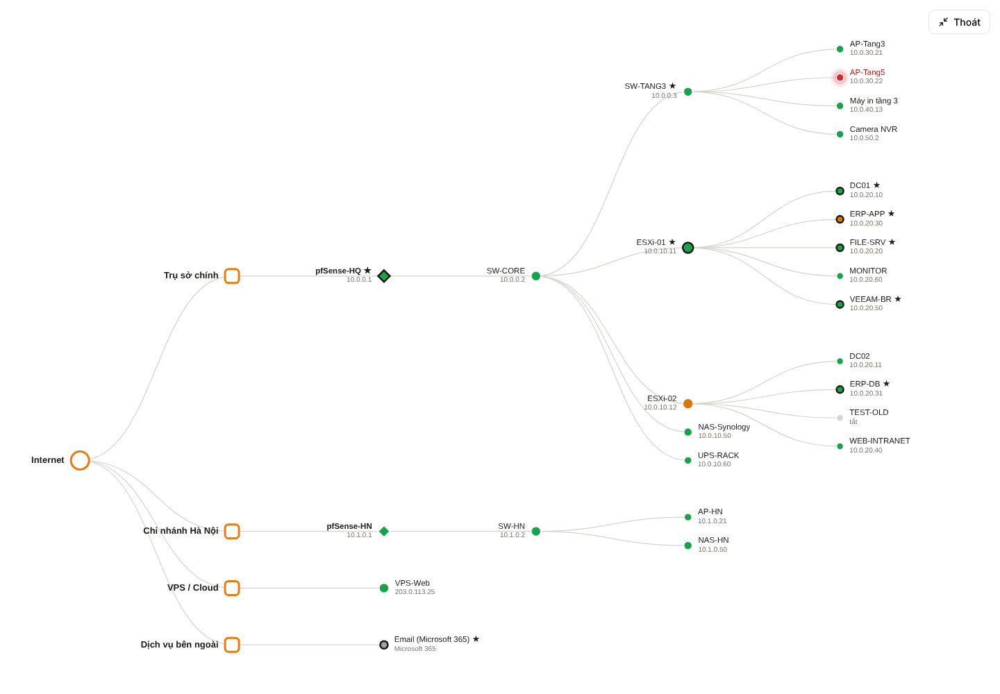

# IT Ops Workspace

Đây là bảng điều khiển hạ tầng IT nội bộ, gồm bản đồ hệ thống, danh sách hệ thống trọng yếu, giám sát và cảnh báo. Tất cả gói trong **một container**, chạy bằng Docker Compose và cấu hình hoàn toàn qua giao diện web.



## Tính năng

| Mục | Mô tả |
|---|---|
| **Bản đồ hệ thống** | Có 3 kiểu xem: *mindmap tỏa tròn*, *dạng cây* và *theo luồng*. Kiểu tỏa tròn và dạng cây đi theo chiều Internet → site → firewall → switch → host → VM → container. Kiểu theo luồng cho thấy hệ thống trọng yếu nào phụ thuộc vào hệ thống nào. Có thể thu gọn VM/container và xuất ảnh PNG. |
| **Điểm rủi ro** | Tự liệt kê các vấn đề: hệ thống chưa backup, chưa biết chạy trên máy nào, chưa có check giám sát; một host gánh nhiều hệ thống High; SSL sắp hết hạn; datastore sắp đầy; snapshot VM cũ; WAN lỗi; nguồn ngừng cập nhật. |
| **Hệ thống trọng yếu** | Khai báo những thứ "chết là cả công ty biết" kèm mức High/Medium/Low, tầng, máy chạy, backup, phụ thuộc và runbook xử lý sự cố. |
| **Sites** | Gom firewall, host, VM, thiết bị và check theo trụ sở, chi nhánh, VPS, cloud. |
| **Tài sản** | Firewall, switch, AP, host, VM, NAS, UPS, máy in, camera... Có thể nhập tay hoặc để hệ thống **tự đồng bộ**. |
| **Giám sát** | Ping, TCP, HTTP(S) + hạn SSL, SNMP v2c/v3, SSH Linux (CPU/RAM/disk/Docker), **VMware ESXi/vCenter**, **pfSense/OPNsense**. |
| **Log thiết bị** | Nhận **Syslog** (UDP/TCP 514, RFC3164/5424; pfSense, Cisco, Aruba, ESXi, Synology…) và **SNMP Trap** (v1/v2c/v3, UDP 162). Log tự gắn vào tài sản theo IP/hostname. **Quy tắc** biến log thành cảnh báo: có sẵn cho cổng switch down/up, WAN pfSense down, ESXi mất datastore, RAID degraded, UPS chạy pin, dò mật khẩu (≥5 lần/5 phút), trap linkDown/linkUp, khởi động lại. Có nút thử quy tắc với log 24h, liệt kê "nguồn lạ", hướng dẫn cấu hình từng hãng. |
| **Cảnh báo** | Mở tự động khi check lỗi liên tiếp và tự đóng khi hoạt động lại. Gửi qua **Telegram, Email, Webhook** (Slack/Teams/Google Chat/Discord). |
| **Nhật ký** | Ghi lại ai thêm, sửa, xoá gì. |
| **Phân quyền** | Có 2 quyền: *Quản trị* (được thêm/sửa/xoá) và *Chỉ xem* (dành cho helpdesk, quản lý). |

## Chạy thử nhanh trên máy cá nhân
Mở thư mục bằng VS Code và bấm F5, xem [CHAY-THU-VSCODE.md](CHAY-THU-VSCODE.md).

## Cài đặt (5 phút)

Cần một máy Linux (VM Ubuntu/Debian, 2 vCPU và 2 GB RAM là đủ) đã cài Docker, đặt trong mạng **thấy được** các thiết bị cần giám sát.

```bash
# 1. Chép thư mục itops lên máy chủ, rồi:
cd itops
cp .env.example .env
nano .env              # đổi ADMIN_PASSWORD, APP_NAME; để DEMO_DATA=true nếu muốn xem thử

# 2. Chạy
docker compose up -d --build

# 3. Mở trình duyệt
http://<IP-máy-chủ>:8080
```

Sau khi đăng nhập lần đầu:
1. Vào **Cài đặt → Tài khoản của tôi** để đổi mật khẩu.
2. Xem qua dữ liệu mẫu. Khi đã quen, vào **Cài đặt → Dữ liệu → Xoá toàn bộ dữ liệu hạ tầng** để bắt đầu nhập hệ thống thật.
3. Vào **Cài đặt → Kênh cảnh báo** để nhập bot Telegram hoặc SMTP, rồi bấm **Gửi thử**.

**Cập nhật phiên bản:** chép code mới đè lên thư mục cũ (giữ nguyên `data/` và `.env`), rồi chạy `docker compose up -d --build`.

**Sao lưu:** chỉ cần sao lưu thư mục `data/` (gồm database SQLite và khoá mã hoá `.secret_key`). Mất `.secret_key` thì mật khẩu thiết bị đã lưu sẽ không giải mã được nữa.

## Thứ tự nhập hệ thống thật (gợi ý)

1. **Sites**: tạo trụ sở, chi nhánh, VPS.
2. **Firewall**: thêm tài sản loại Firewall cho từng site, rồi thêm check *pfSense* gắn vào firewall đó.
3. **Switch**: thêm tài sản Switch với "Nằm sau" là firewall, rồi thêm check *SNMP*.
4. **ESXi**: thêm tài sản Host với "Nằm sau" là switch, rồi thêm check *ESXi*. Toàn bộ VM sẽ **tự hiện lên bản đồ** dưới host đó.
5. **Hệ thống trọng yếu**: khai báo AD, ERP, file server, email... và chọn VM tương ứng.
6. Đánh dấu **backup** cho từng VM hoặc hệ thống (Sửa → "Đã có backup"). Mục *Chưa sao lưu* sẽ giảm dần về 0.

## Nhận Syslog & SNMP Trap
Mặc định container mở **514/udp, 514/tcp** (syslog) và **162/udp** (trap). Trỏ thiết bị về `IP-máy-chủ:514` / `IP-máy-chủ:162`. Lệnh mẫu cho pfSense, Cisco, Aruba, ESXi, Synology, UPS APC, FortiGate, Linux, Windows có trong **Log thiết bị → Hướng dẫn cấu hình thiết bị** (điền sẵn IP).

- **Chỉ IP nội bộ được gửi log/trap** (mặc định 10.0.0.0/8, 172.16.0.0/12, 192.168.0.0/16). IP ngoài danh sách bị chặn và hiện cảnh báo đỏ ở trang Log. Sửa danh sách, community trap và user SNMPv3 ở **Cài đặt → Nhận Syslog / Trap**.
- Bấm **Gửi thử syslog / Gửi thử trap** ở trang Log để kiểm tra đường ống.
- Log được giữ `EVENT_RETENTION_DAYS` ngày (mặc định 30) và tối đa `MAX_EVENTS` dòng. Mỗi thiết bị bị giới hạn `EVENTS_PER_SEC_PER_SOURCE` log/giây để chống flood.
- Log gói tin firewall (`filterlog`) của pfSense mặc định **không lưu** vì quá nhiều. Muốn lưu thì tắt quy tắc "Bỏ qua log gói tin firewall".
- Nếu cổng 514/162 trên máy chủ đã bị chiếm (VD đã có rsyslog), đổi `SYSLOG_PORT` / `TRAP_PORT_HOST` trong `.env`.
- Đã test ~3.000 log/giây từ 20 thiết bị, không mất log nào.

## Chuẩn bị trên thiết bị

### pfSense
**Cách 1, khuyến nghị: REST API.** Lấy được CPU/RAM, gateway WAN (loss/latency), interface, IPsec/OpenVPN và DHCP lease.
1. *System → Package Manager → Available Packages*. Gói REST API không có sẵn trong danh sách mặc định; xem hướng dẫn cài tại **pfrest.org** (cài qua lệnh `pkg-static add <link-gói>` trong *Diagnostics → Command Prompt*, chọn đúng bản theo phiên bản pfSense).
2. *System → REST API → Settings*: bật API và chọn xác thực bằng **API Key**.
3. *System → REST API → Keys*: tạo key. Nên tạo một user riêng có quyền đọc.
4. Trong IT Ops, thêm check loại **pfSense / OPNsense**: địa chỉ là IP web GUI, dán API key vào, bấm **Chạy thử**.

**Cách 2: SNMP**, khi không muốn cài thêm gói. Vào *Services → SNMP*, bật, đặt community, rồi chọn "Cách lấy dữ liệu: SNMP" trong check.

**OPNsense:** dùng API có sẵn. Vào *System → Access → Users → API keys*, tạo cặp key/secret.

### VMware ESXi / vCenter
- Nên tạo một user **chỉ đọc**: ESXi Host Client → *Manage → Security & users → Users* để thêm user, rồi gán role *Read-only* tại *Host → Actions → Permissions*. Với vCenter thì gán role Read-only ở cấp datacenter.
- Nếu trỏ check vào **vCenter**, hệ thống sẽ tự tạo tài sản cho tất cả host và VM.
- Hệ thống thu thập: CPU/RAM host, datastore (cảnh báo khi ≥ 85%), VM bật/tắt, IP, HĐH, VMware Tools, snapshot cũ.

### Switch, AP, UPS, NAS (SNMP)
- Bật SNMP v2c (read-only, đặt community riêng, giới hạn ACL theo IP máy chạy IT Ops) hoặc SNMPv3.
- Chọn *Loại thiết bị*: **Chung** cho switch/router/AP, **UPS** cho APC/Eaton có card mạng, **Synology** cho NAS Synology.
- Điền *Cổng quan trọng* (VD: `Gi1/0/48` uplink lên firewall). Cổng đó down sẽ mở cảnh báo đỏ.

### Máy Linux (SSH)
- Nên dùng user riêng với SSH key. User cần quyền chạy `docker ps` nếu muốn liệt kê container (thêm vào group `docker`).
- Hệ thống thu thập: uptime, load, RAM, disk từng mount, danh sách container (các container này cũng hiện lên bản đồ).

### Telegram
1. Chat với **@BotFather** → `/newbot` → lấy token.
2. Thêm bot vào nhóm IT, gửi một tin bất kỳ, rồi mở `https://api.telegram.org/bot<TOKEN>/getUpdates` để lấy `chat.id` (thường là số âm `-100...`).

## Cấu trúc

```
itops/
├── docker-compose.yml, Dockerfile, .env.example
├── backend/app/
│   ├── main.py          API (FastAPI)
│   ├── scheduler.py     vòng lặp giám sát, mở/đóng cảnh báo, đồng bộ tài sản
│   ├── topology.py      bản đồ, hệ thống trọng yếu, điểm rủi ro
│   ├── collectors/      ping, tcp, http, snmp, ssh, esxi, pfsense
│   ├── notify.py        Telegram / Email / Webhook
│   └── seed.py          dữ liệu mẫu
└── frontend/src/        giao diện React + ECharts
```

## Bảo mật
- Mật khẩu, community, API key của thiết bị được **mã hoá** trong database và không bao giờ trả về trình duyệt.
- Chỉ nên mở cổng web trong mạng nội bộ hoặc qua VPN. Nếu cần HTTPS, đặt phía sau Nginx Proxy Manager hoặc reverse proxy sẵn có.
- Dùng tài khoản **chỉ đọc** trên thiết bị (ESXi Read-only, SNMP read-only, user API hạn chế quyền).

## Kiểm thử (QA)
Bộ test nằm ở `backend/tests/` và gồm: API/phân quyền, collector chạy với thiết bị giả lập (pfSense, OPNsense, ESXi, Telegram, SMTP), SNMP/SSH chạy với agent thật, luồng cảnh báo, E2E giao diện, XSS và test tải. Kết quả chi tiết xem ở [QA_REPORT.md](QA_REPORT.md).
```bash
cd backend && pip install -r requirements-dev.txt && bash tests/run_all.sh
```

## Xử lý sự cố
| Hiện tượng | Kiểm tra |
|---|---|
| Ping báo "Không phản hồi" dù thiết bị sống | Firewall có chặn ICMP từ máy chạy IT Ops không? Container có `cap_add: NET_RAW` chưa? |
| SNMP "không phản hồi" | Community, ACL trên thiết bị, UDP 161 có bị chặn không? Thử `snmpwalk -v2c -c <community> <ip> system` từ máy chủ. |
| pfSense trả về 404 | Chưa cài gói REST API, hoặc đang dùng sai phiên bản (cần API v2). |
| pfSense trả về 401/403 | Sai API key, hoặc chưa bật xác thực bằng API Key. |
| ESXi lỗi đăng nhập | User/mật khẩu sai, hoặc user chưa được gán quyền. |
| Không đăng nhập được, báo "thử lại sau" | Đã nhập sai mật khẩu 5 lần nên bị khoá 5 phút, hoặc khởi động lại container để mở khoá. |
| Quên mật khẩu admin lần đầu | Nếu không đặt `ADMIN_PASSWORD`, mật khẩu ngẫu nhiên được in trong `docker compose logs itops`. |
| Xem log | `docker compose logs -f itops` |
